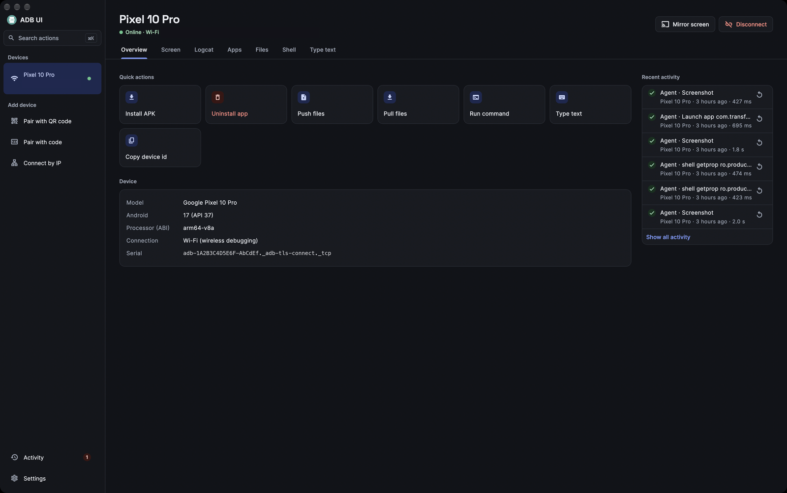
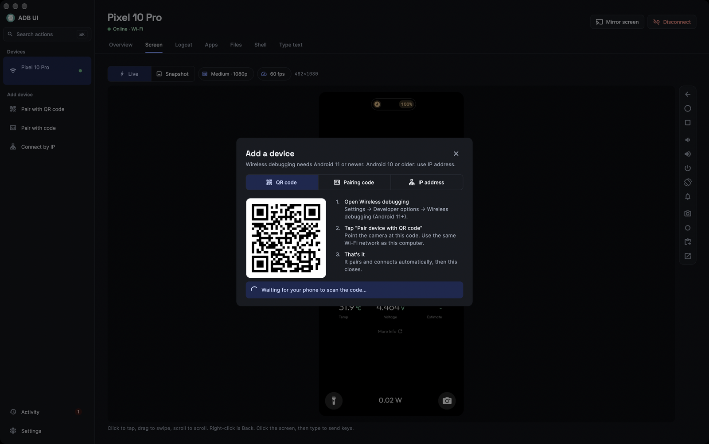
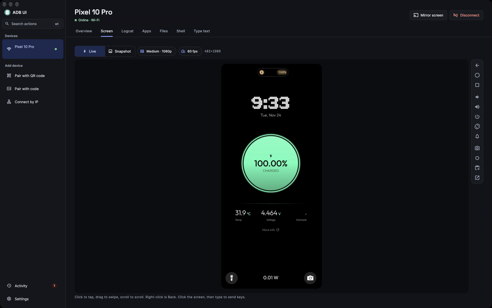
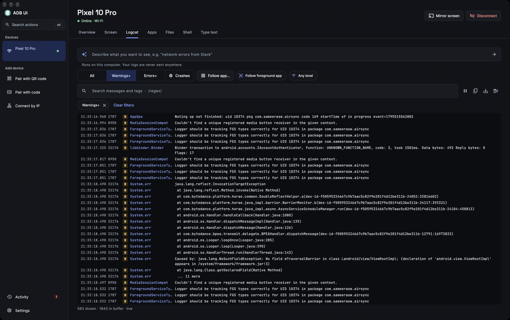
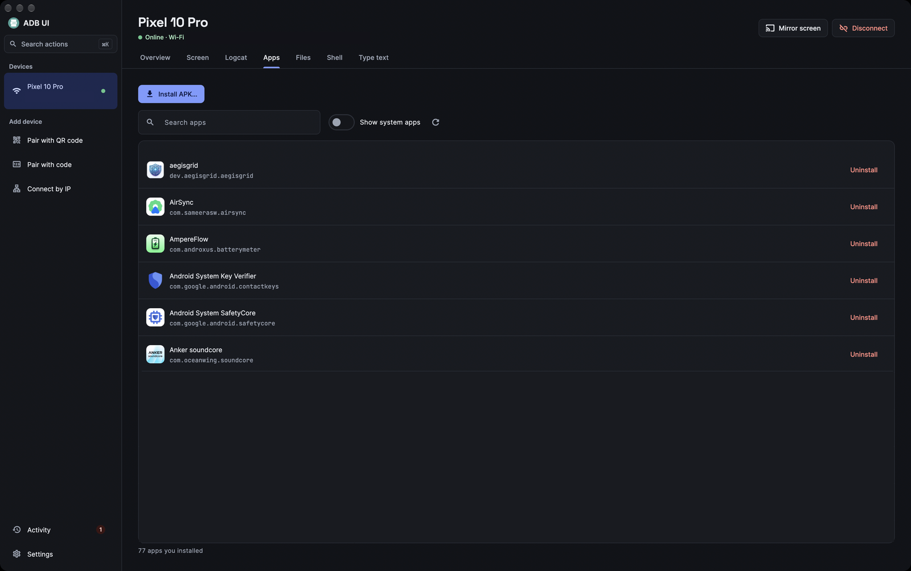
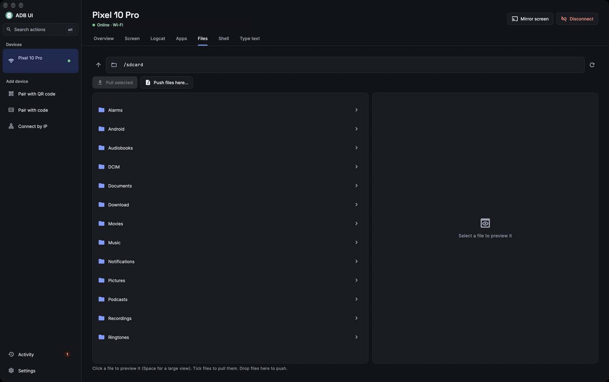
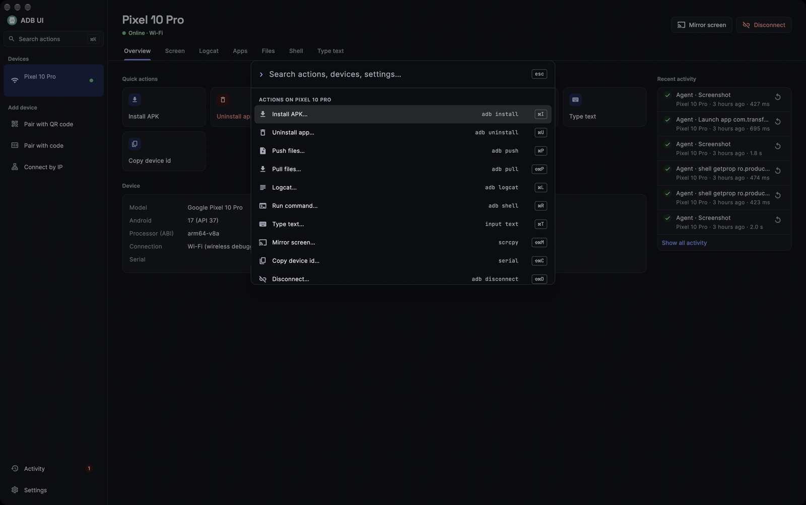
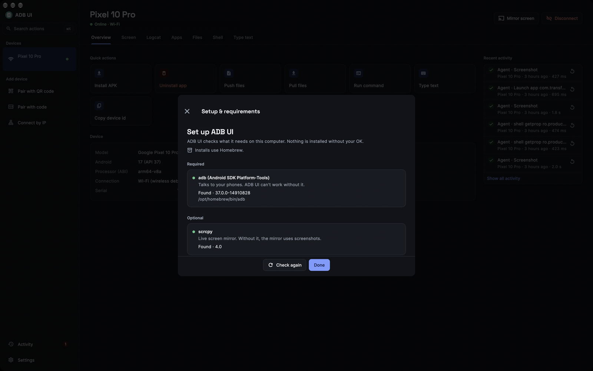

# ADB UI

**A desktop app for your Android phone, so you don't have to type `adb` commands.**
Connect over USB, Wi-Fi or a QR code, then install apps, browse files, read logs, mirror the
screen and run commands, all from one window. Free and open source, for **Windows, macOS and
Linux**.

[](https://github.com/IsmailAlamKhan/adb_ui/releases/latest)

[](https://github.com/IsmailAlamKhan/adb_ui/releases)

**[Download the latest release →](https://github.com/IsmailAlamKhan/adb_ui/releases/latest)**



## Highlights

- **Connect without a cable.** Scan a QR code with your phone, like Android Studio, or use a
  pairing code or an IP address.
- **See and control the phone** inside the app, with buttons for Back, Home, volume, rotate,
  screenshots and screen recording.
- **Logcat that's easy to read,** with one-click filters, and an **AI filter that runs on your
  computer**: describe what you want in plain words and your logs never leave the machine.
- **Let AI agents use your phone.** Claude Code and other MCP clients can take screenshots,
  tap, read logs and run UI tests through ADB UI. You approve anything risky.
- **Sets itself up.** On first launch it checks for adb and scrcpy and installs them for you,
  with your OK.
- **Updates itself** in place, and shows what's new after each update.

## A quick tour

### Connect a phone in seconds
Plug in a cable, or press **⌘N / Ctrl+N** and scan the QR code from **Developer options →
Wireless debugging** (Android 11+). It pairs and connects by itself.



### Screen mirror
See the phone live and use it with your mouse and keyboard. scrcpy powers the live view;
without it, ADB UI shows refreshed screenshots instead.



### Logcat, with an AI filter
Live device logs with filters for warnings, errors and crashes. It can follow one app, even
when it restarts, or whichever app is open on the phone. Or type what you're after, like
"network errors from Slack", and a small model **on your computer** builds the filter.



### Apps
Every installed app with its real icon and name. Install an APK (or drop it on the window)
and uninstall from the list.



### Files
Browse the phone's storage, preview photos, videos, music and text right in the app, push
files to the folder you're in and pull files back.



### Every action, one shortcut away
Press **⌘K / Ctrl+K** to search every action, device and setting. Each action shows the adb
command it runs.



### Set up for you
**Setup & requirements** shows what's installed and installs what's missing through Homebrew,
winget or your Linux package manager, or downloads the official builds. Nothing is installed
without your OK.



### And also
- **Shell and Type text:** run any adb command, or type text into the phone's focused field.
- **Activity:** every command is recorded with its output, so you can see what happened and
  run it again.
- **Three styles** (Workbench, Console, Launcher), each with a light and a dark theme. It also
  works in a small window.
- **Clear errors:** when something fails, ADB UI says what went wrong and what to try next.
  The raw output is one click away.
- **Restart adb** from Settings or the palette when a phone stops showing up over Wi-Fi.

## AI agents (MCP)

ADB UI can act as an [MCP](https://modelcontextprotocol.io) server, so Claude Code and other
AI agents can work with your phone: take screenshots, tap and type, read logcat, browse
files, and run UI tests that save a report with screenshots.

1. Open **Settings → AI agents** and turn on **Let AI agents use ADB UI**. It only listens on
   this computer.
2. Click **Copy Claude Code command** and run it in a terminal, or **Copy JSON config** for
   another client.
3. Ask the agent something like "open the app and check the welcome text".

Installing or uninstalling apps, clearing data, shell commands and file copies ask you first
with **Allow** / **Deny**. Details in the [user guide](docs/user-guide.md#ai-agents-claude-and-other-mcp-clients).

## Requirements

| | Needed? | Why |
|---|---|---|
| **adb** (Android platform-tools) | **Required** | ADB UI runs it for everything. ADB UI can install it for you (see below). |
| **scrcpy** | Optional | Smooth, real-time screen mirroring. Without it, the Screen tab shows refreshed screenshots instead. |
| **libmpv** (Linux only) | Required on Linux | Plays the mirrored screen. |
| macOS **14 (Sonoma)** or newer | macOS only | Needed since 0.0.17 for the on-device AI. |

**Let ADB UI install them.** On first launch, and whenever adb is missing, ADB UI opens
**Set up ADB UI**: a list of what's required and what's optional, with an **Install** button for
each. It uses your package manager (Homebrew, winget, or apt/dnf/pacman/zypper) and shows the
exact command before running it. Without a package manager, or if you click **Download
instead**, it downloads the official build (Platform-Tools from Google, scrcpy from its GitHub
releases), checks its checksum and keeps it in its own folder, so you don't need to change your
`PATH`. Nothing is installed without your OK, and on Linux it never runs `sudo` itself: you
copy the command or approve it through `pkexec`. Open it again any time from **Settings → Setup
& requirements** or the command palette.

**Or install them yourself:**

- **macOS** (Homebrew): `brew install android-platform-tools scrcpy`
- **Windows** (winget): `winget install Google.PlatformTools Genymobile.scrcpy`, or download
  [platform-tools](https://developer.android.com/tools/releases/platform-tools) and add the
  folder to your `PATH`.
- **Linux** (Debian/Ubuntu): `sudo apt install adb scrcpy libmpv2` (on older releases
  `libmpv1`).

Check it worked by running `adb version` in a new terminal.

## Install

Get the files from the [releases page](https://github.com/IsmailAlamKhan/adb_ui/releases/latest).

### Windows
- **Installer (recommended):** download `adb-ui-setup-windows.exe` and run it.
- **Portable:** download `adb-ui-windows.zip`, extract it anywhere and run `adb_ui.exe`.

### macOS
1. Download `adb-ui-setup-macos.dmg`, open it and drag **ADB UI** to Applications.
2. The app isn't notarized by Apple yet, so the first time macOS may say it can't be opened.
   Right-click the app and choose **Open**, or go to **System Settings → Privacy & Security**
   and click **Open Anyway**.

### Linux
1. Install `libmpv2` (see Requirements).
2. Download `adb-ui-setup-linux.zip`, extract it (for example to `~/Applications/adb-ui/`) and
   run `adb_ui`.
3. *(Optional)* To get it in your app launcher, open the included `adb-ui.desktop`, replace
   `<Path to the instalation>` with the folder you extracted to, and copy the file to
   `~/.local/share/applications/`.

After that, ADB UI keeps itself up to date: when a new version is out it shows what changed
and installs it with one click.

## Quick start

1. On your phone, turn on **Developer options** (Settings → About phone → tap *Build
   number* 7 times), then turn on **USB debugging**.
2. Plug the phone in and tap **Allow** on the "Allow USB debugging?" prompt.
3. Open ADB UI and pick a style (you can change it later in Settings).
4. Your phone appears in the device list. Select it and use the tabs or actions.
5. Press **⌘K** (Ctrl+K on Windows/Linux) to search every action.

To connect **without a cable** (Android 11+), press **⌘N / Ctrl+N** → **QR code**, then on the
phone go to **Developer options → Wireless debugging → Pair device with QR code** and scan.

## Documentation

- **[User guide](docs/user-guide.md):** every feature, step by step: connecting, apps, files,
  logcat, the AI filter, screen mirror, Activity, styles, settings and keyboard shortcuts.
- **[Troubleshooting](docs/troubleshooting.md):** common problems ("no devices", "unauthorized",
  pairing fails, the mirror won't start, macOS won't open the app) and what to do.
- **[Changelog](CHANGELOG-ALL.md):** what changed in each version.

## Privacy

- ADB UI talks to your devices through your own `adb`. It has no account and no analytics.
- It goes online only to check GitHub for updates and, if you choose, to download the AI
  model once from Hugging Face. The AI filter then works offline, and your logs and requests
  stay on your computer.
- The AI agent server is off until you turn it on, listens only on this computer and needs a
  token.
- Logs of the app itself stay on your computer. A bug report pre-fills the GitHub issue with
  your setup and recent log lines (your home folder and PATH removed) in your browser, where
  you can read and edit them before submitting; the full zip is only shared if you attach it.

## Reporting bugs and requesting features

In the app: **Settings → About → Report a bug or request a feature**. For a bug it opens a
GitHub issue already filled in with your setup and recent log lines, and saves the full logs
to your Downloads folder, ready to drag onto the issue. Or open an
[issue](https://github.com/IsmailAlamKhan/adb_ui/issues/new/choose) directly.

## Contributors

Huge thanks to everyone who opened issues and feature requests, tested the app and gave
feedback.

Special thanks to [@roipeker](https://www.github.com/roipeker/) for running the app on macOS
and helping with the macOS build.

## Contributing

ADB UI is built with Flutter. The app is fully specified in [`spec/`](spec/README.md), and
changes are spec-first: update the spec, then the code. See
[`spec/WORKFLOW.md`](spec/WORKFLOW.md).

```bash
flutter pub get
flutter run -d macos   # or windows / linux
```
